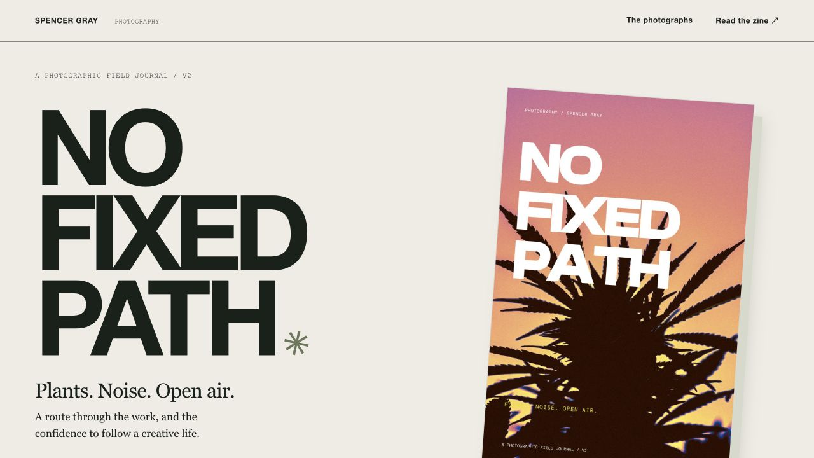

# No Fixed Path

A photographic field journal by **Spencer Gray**: cannabis, live music, open air, and the confidence to follow a creative path.

**Live edition:** https://no-fixed-path.vercel.app/

Vercel is connected to this GitHub repository. Pushes to `main` deploy the production site automatically.

Version 2 is a 48-page zine with 47 unique photographs: 30 cannabis, nine concert and eight nature photographs. This revision includes two Dijon images and two Allan Rayman images selected from Spencer's archive. The personal narrative includes Spencer's own account of LSD helping him believe in himself and choose a creative life.

## Web edition

A static, responsive portfolio with a complete 48-page reader, chapter jumps, keyboard navigation, accessible page selection and a downloadable reader PDF. The site includes a curated 1200 × 630 social image, Open Graph and Twitter metadata, a canonical production URL, sitemap and favicon. It has no analytics, tracking, external fonts or build dependencies.

Run locally with `python3 -m http.server 4175`, then open http://localhost:4175. Deploy as a static “Other” project on Vercel with the repository root as output. `vercel.json` records the configuration.

- `index.html`: narrative and selected photographs.
- `style.css`: responsive design.
- `reader.js`: page and chapter navigation.
- `assets/pages/`: optimized images of all 48 designed pages.
- `assets/gallery/`: display derivatives of selected photographs, with location metadata omitted.
- `assets/share.jpg`: curated social preview.
- `No-Fixed-Path-v2-Reader.pdf`: complete reading edition.

The editable InDesign package, full-resolution originals, private photo-source paths and printer quotations are preserved separately in the owner's local production package. The original v1 edition was retained unchanged. This repository is the public web edition, not a full-resolution production archive.

## Validation

The native v2 package passed 48-page, link, font, overset and effective-resolution checks (minimum 300 ppi). The print master is a sequential, single-page CMYK PDF/X-4 with 0.125-inch bleed; the linked reader PDF is trimmed to 5.5 × 8.5 inches with two-page-right display preference. The web edition was checked at desktop and 390-pixel mobile widths, including chapter/page navigation and PDF availability. Deployment evidence is recorded in the local handoff.

## Rights

All photography and personal narrative © Spencer Gray. See [RIGHTS.md](RIGHTS.md). The public availability of this repository is not a grant to reuse the photographs. Design and editorial assistance: Codex, as credited in the zine.
